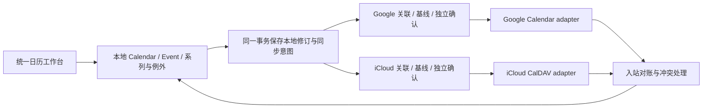

# Calendar 重新审核与修正计划

日期：2026-10-19。审核基线：`main` / `5a6825fa1edcc8cfdbf79b8e10ff882b0f935ff8`。

状态：用户已批准实施（“LGTM, start implement”）。修正代码位于 `codex/calendar-local-first`，保留以下审核证据作为实施前基线。[操作与迁移说明](../../CALENDARS.md)和[实施验收记录](../implementation/calendar-validation.md)描述本次结果；真实 Google/iCloud 服务联合验收仍为 NOT RUN。没有迁移开发数据库或执行真实云端写入。

## 1. 产品目标与审核结论

目标是一个可以独立使用的本地日历，同一本地日历可以同时与 Google Calendar、iCloud Calendar 双向同步事件。没有邮箱 Account、没有云端授权、网络不可用时，都能使用本地日历。连接或移除其中一个同步服务，不应改变本地日历和事件的身份，也不应停止另一个服务的同步。

当前实现已有无 Account 的本地 Calendar/Event CRUD，不能把问题归结为“完全没有本地日历”。偏差出在它把本地日历、邮箱 Account、iCloud collection、DAV resource 的身份和生命周期混在一起：绑定目标需要接管另一份本地日历，解除关联受到资源绑定限制，邮箱删除还会清理本地日历。

把 Calendar、Event、协议资源放在不同模块本身合理；需要纠正的是业务身份与外部服务的关系，以及面向用户暴露的接管、复制和删除语义。保留现有 umbrella 边界，不以合并模块或重写全部连接器解决问题。

用户已明确选择“同一个本地日历可同步 Google 和 iCloud”。因此本计划要求本地 Calendar 对应多个独立同步目标，跨服务传播、循环抑制、每个目标独立确认与冲突处理都属于本轮必需范围。页面中保留一份本地日历和一份事件；两家服务是这份数据的同步目标。已接受的任一服务端事件修改，经本地模型传播到另一服务，不建立绕过本地模型的 Google → iCloud 直接转发路径。

## 2. 当前问题与证据

以下源码链接固定到审核基线 `5a6825f`，用于保留修正前证据；当前行为及验证结果见实施验收记录。

### R1 / P1：本地数据生命周期被邮箱 Account 接管

- [Calendar schema](https://github.com/gsmlg-opt/manifold/blob/5a6825fa1edcc8cfdbf79b8e10ff882b0f935ff8/apps/manifold_data/lib/manifold/data/schema/calendar.ex) 包含 `account_id`、`sync_to_icloud`、单个 `collection_id`；[Account schema](https://github.com/gsmlg-opt/manifold/blob/5a6825fa1edcc8cfdbf79b8e10ff882b0f935ff8/apps/manifold_accounts/lib/manifold/accounts/schema/account.ex) 实际映射 `mailboxes`，要求邮箱域和 local part。
- [iCloud purge，296 行](https://github.com/gsmlg-opt/manifold/blob/5a6825fa1edcc8cfdbf79b8e10ff882b0f935ff8/apps/manifold_connectors/lib/manifold/connectors/icloud.ex#L296) 按 Account 清理事件和日历，包括从未绑定云端的本地事件。
- [生命周期测试，47 行](https://github.com/gsmlg-opt/manifold/blob/5a6825fa1edcc8cfdbf79b8e10ff882b0f935ff8/apps/manifold_account_lifecycle/test/manifold/account_lifecycle/icloud_test.exs#L47) 明确创建纯本地日历，随后断言删除邮箱 Account 会删除该日历及事件。

性质：当前行为符合旧的 Account 所属方案，却不符合本轮要求的独立本地日历。日历所有权必须与邮箱配置分离。

### R2 / P1：连接同步目标被实现成合并和替换本地日历

- [create/update_calendar，37–93 行](https://github.com/gsmlg-opt/manifold/blob/5a6825fa1edcc8cfdbf79b8e10ff882b0f935ff8/apps/manifold_calendars/lib/manifold/calendars.ex#L37) 在接管目标时移动事件并删除原目标对应的本地 Calendar。
- [ensure_mapping_change!，452 行](https://github.com/gsmlg-opt/manifold/blob/5a6825fa1edcc8cfdbf79b8e10ff882b0f935ff8/apps/manifold_calendars/lib/manifold/calendars.ex#L452) 在已有绑定事件时拒绝更改或清空目标，要求创建副本。
- [测试，385–445 行](https://github.com/gsmlg-opt/manifold/blob/5a6825fa1edcc8cfdbf79b8e10ff882b0f935ff8/apps/manifold_calendars/test/manifold/calendars_test.exs#L385) 明确断言原 Calendar ID 消失，后续取消关联返回 `local_copy_required`。

用户只是配置同步，却需要理解两份 Calendar 的接管和合并。同步关联应独立增删；本地 Calendar ID 不应因此被替换。一个远端日历已有关联时，应打开既有本地日历或要求明确解除旧关联，不能把普通设置保存当作合并入口。

### R3 / P1：断开后重连没有身份连续性

- [disconnect，152 行](https://github.com/gsmlg-opt/manifold/blob/5a6825fa1edcc8cfdbf79b8e10ff882b0f935ff8/apps/manifold_connectors/lib/manifold/connectors/icloud.ex#L152) 暂停资源后直接删除 connection。
- [初始迁移，51 行](https://github.com/gsmlg-opt/manifold/blob/5a6825fa1edcc8cfdbf79b8e10ff882b0f935ff8/apps/manifold_data/priv/repo/migrations/20261010000100_add_icloud_contacts_calendars.exs#L51) 使 connection 删除级联删除 collections；[后续迁移](https://github.com/gsmlg-opt/manifold/blob/5a6825fa1edcc8cfdbf79b8e10ff882b0f935ff8/apps/manifold_data/priv/repo/migrations/20261010000200_add_account_icloud_sync_state.exs) 保留本地行但置空关联外键。
- 新连接生成新 UUID；[discovery，130 行](https://github.com/gsmlg-opt/manifold/blob/5a6825fa1edcc8cfdbf79b8e10ff882b0f935ff8/apps/manifold_connectors/lib/manifold/connectors/icloud/sync.ex#L130) 和 [inbound，190 行](https://github.com/gsmlg-opt/manifold/blob/5a6825fa1edcc8cfdbf79b8e10ff882b0f935ff8/apps/manifold_connectors/lib/manifold/connectors/icloud/inbound.ex#L190) 按新连接/collection 建立身份。

静态路径推导：导入 → 断开 → 用同一 Apple 身份重新连接，会保留旧本地记录，并重新导入新的 Calendar/Event；旧 pending 资源失去可恢复的目标。已有测试验证了断开后保留数据，没有验证同一身份重连的连续性。本次没有操作真实账户复现。

重新授权必须核实服务身份并恢复既有映射；换成不同身份时必须创建新的关联，禁止猜测或自动复用。

### R4 / P1：重复事件没有成为可用的本地日历语义

- [范围查询，150 行](https://github.com/gsmlg-opt/manifold/blob/5a6825fa1edcc8cfdbf79b8e10ff882b0f935ff8/apps/manifold_calendars/lib/manifold/calendars.ex#L150) 只按存储的 `starts_at`/`ends_at` 筛选；很早开始但仍重复的系列会在展开前被排除。
- [Display.on_day?，42 行](https://github.com/gsmlg-opt/manifold/blob/5a6825fa1edcc8cfdbf79b8e10ff882b0f935ff8/apps/manifold_web/lib/manifold_web/live/calendar_live/display.ex#L42) 只判断存储的单次起止时间，没有 RRULE 展开。
- [Document.delete_event，177 行](https://github.com/gsmlg-opt/manifold/blob/5a6825fa1edcc8cfdbf79b8e10ff882b0f935ff8/apps/manifold_connectors/lib/manifold/connectors/dav/document.ex#L177) 删除已改期 occurrence 的例外组件，却不增加 EXDATE 或取消标记；主 RRULE 仍然产生原来的那次日程。
- [现有同步测试，329 行](https://github.com/gsmlg-opt/manifold/blob/5a6825fa1edcc8cfdbf79b8e10ff882b0f935ff8/apps/manifold_connectors/test/manifold/connectors/icloud/bidirectional_test.exs#L329) 只验证 RECURRENCE-ID 消失且 RRULE 保留。

必须区分“删除这一次”“撤销这一次的改期”“删除整个系列”。存储组件删除不等于用户理解的 occurrence 删除。跨月、例外、排除日、夏令时必须在本地查询和同步两侧使用一致语义。

### R5 / P1：查看时区未参与日期与时间计算

[Display.date/clock](https://github.com/gsmlg-opt/manifold/blob/5a6825fa1edcc8cfdbf79b8e10ff882b0f935ff8/apps/manifold_web/lib/manifold_web/live/calendar_live/display.ex#L4) 直接截取原字符串。`20261019T233000Z` 在上海应为 10 月 20 日 07:30，当前显示辅助函数得到 10 月 19 日 23:30。页面提示保留源时区不能替代统一查看时区，否则不同来源无法放在同一个日程视图中比较。

需要保留 DATE、UTC、floating 和 TZID 的原始含义，同时按查看时区计算 timed event 的显示日期和范围；全天事件保持日期语义，不能一律转 UTC。

### R6 / P1：Google Calendar 同步不存在

[Gmail OAuth 定义，9 行](https://github.com/gsmlg-opt/manifold/blob/5a6825fa1edcc8cfdbf79b8e10ff882b0f935ff8/apps/manifold_connectors/lib/manifold/connectors/oauth_provider/gmail.ex#L9) 只有 receive/send、Gmail scopes 和 Gmail API 地址。[旧工作台维护记录](../../../.agents/skills/develop/references/contacts-calendar-workspace.md) 明确称 Google 仅为视觉参考。

这是产品范围缺失，不是补一个 Google 按钮即可完成。需要 Calendar 专用授权、日历发现、事件读写、增量同步和错误恢复；不能把 Gmail 授权当作已有 Calendar 授权。

### R7 / P1：本地复制可能触发云端上传，还会丢失系列语义

- [复制表单，842 行](https://github.com/gsmlg-opt/manifold/blob/5a6825fa1edcc8cfdbf79b8e10ff882b0f935ff8/apps/manifold_web/lib/manifold_web/live/calendar_live/index.ex#L842) 标为 `Make local copy`，但目标包含所有可创建事件的日历，包括已绑定 iCloud 的日历。
- [copy_event，298 行](https://github.com/gsmlg-opt/manifold/blob/5a6825fa1edcc8cfdbf79b8e10ff882b0f935ff8/apps/manifold_calendars/lib/manifold/calendars.ex#L298) 调用普通 create 流程，因此选中同步日历会排队上传；复制字段不含重复规则、排除日和例外。

应区分“复制此 occurrence”“复制整个系列”和“复制到会同步的目标”；提交前显示是否会上传。复制必须生成新的业务身份，并明确保留的系列范围。

### R8 / P2：日历工作台不能表达完整日程与独立同步操作

- [页面加载，38 行](https://github.com/gsmlg-opt/manifold/blob/5a6825fa1edcc8cfdbf79b8e10ff882b0f935ff8/apps/manifold_web/lib/manifold_web/live/calendar_live/index.ex#L38) 只查询一个选中 Calendar，侧栏用于切换而非叠加显示。
- 删除非空 Calendar 被拒绝，而删除其中同步事件可能删除云端事件；没有按日历隐藏、暂停、解除同步并保留数据的完整操作路径。
- CalendarLive 没有订阅同步完成消息；状态和新事件要等导航/刷新。冲突操作作用于整个远端资源，页面却没有远端版本和受影响系列的预览。

“显示哪些日历”“新事件存到哪个日历”“这个日历同步到哪里”应为三个独立选择。保留 DuskMoon 设计系统，不在本轮重做无关页面。

### R9 / P2：远端权限和不支持的操作未形成清晰能力模型

- [ensure_editable!，472 行](https://github.com/gsmlg-opt/manifold/blob/5a6825fa1edcc8cfdbf79b8e10ff882b0f935ff8/apps/manifold_calendars/lib/manifold/calendars.ex#L472) 在同步开启时用 collection 权限阻止本地事件写入。
- [Document.event，116 行](https://github.com/gsmlg-opt/manifold/blob/5a6825fa1edcc8cfdbf79b8e10ff882b0f935ff8/apps/manifold_connectors/lib/manifold/connectors/dav/document.ex#L116) 拒绝带 ORGANIZER/ATTENDEE 的资源写回；本地保存后才在 worker 中失败，可能持续重试。

这些保护不应直接删除。需要区分本地保存能力、来源是否只读、目标是否允许上传，以及当前不支持的 scheduling 操作。只读来源采用入站模式，或显式复制为可编辑本地事件；不支持的写回显示稳定、可操作的状态，不能显示成功或无限重试。

### R10 / P1：现有单目标结构不能承载同日历多目标同步

[Calendar schema](https://github.com/gsmlg-opt/manifold/blob/5a6825fa1edcc8cfdbf79b8e10ff882b0f935ff8/apps/manifold_data/lib/manifold/data/schema/calendar.ex#L9) 只有一个 `collection_id`；[CalendarEvent schema](https://github.com/gsmlg-opt/manifold/blob/5a6825fa1edcc8cfdbf79b8e10ff882b0f935ff8/apps/manifold_data/lib/manifold/data/schema/calendar_event.ex#L10) 只有一个 DAV `resource_id`；[stage_event，100 行](https://github.com/gsmlg-opt/manifold/blob/5a6825fa1edcc8cfdbf79b8e10ff882b0f935ff8/apps/manifold_data/lib/manifold/data/sync_state.ex#L100) 直接按该 collection 和 iCloud preference 建立意图。

这与用户本轮明确确认的需求不兼容。同一事件的 Google 和 iCloud 必须有独立映射、远端版本、共同基线、待发送修订、已确认修订及冲突/未知结果；一家的成功不能确认另一家的待办。只增加第二个远端 ID 或共用一个同步状态仍无法正确处理部分失败和并发更新。

## 3. 建议模型与方案取舍

推荐在现有应用边界内，重构本地业务模型与同步关联，复用已经验证的协议安全机制。

| 方案 | 结果与取舍 |
| --- | --- |
| 推荐：稳定本地模型 + 多目标同步关联 + 两个 provider adapter | 能修复所有权、重连、重复事件，并支持同一日历同时同步两家；需要迁移映射和调用路径，但可保留已有 DAV 保护 |
| 只改页面、继续向 Calendar 添加 Google 字段 | 改动少，但延续邮箱生命周期、替换本地 ID 和 provider 分支，不能解决根因 |
| 全量重写 Calendar 与 DAV | 改动和回归面最大，容易丢掉条件写、未知结果恢复及完整资源保护，没有必要 |

业务链路：

- **本地模型**：本地日历和事件使用稳定 ID，属于现有应用的本地数据边界，不以 mailbox 为所有者；不为此次修正新造用户/租户体系。保留事件修订、软删除、系列规则、例外和时间类型。Occurrence 是有界查询结果，不预先无限生成数据库行。
- **连接身份**：provider、经核实的远端身份和凭证引用独立于邮箱 Account。可以复用 OAuth provider Settings 和加密机制，授权生命周期不随 Gmail 收发方式或邮箱删除而清除。
- **日历关联**：本地 Calendar 对应零到多个同步关联，Google 和 iCloud 可同时激活；每个关联保存远端日历标识、方向、权限、暂停状态和 checkpoint。同一 provider 身份下的一个远端日历只关联一个本地 Calendar，禁止重复建立同一目标；不限制本地日历只能有一个目标。
- **事件/资源关联**：同一本地 Event/系列可以有多个目标映射。按目标保存远端事件或资源身份、共同基线、ETag、原始 ICS/JSON、期望/已确认/已发送修订、重试、冲突和未知结果。不能只给 Event 增加 `google_id`，也不能用 UID/标题/时间跨服务自动合并。iCloud 的多个组件共享完整 ICS 资源；Google 的系列与实例按其自身标识映射；完整资源发送记录须包含本次涉及的本地组件修订，不能假设资源与事件一一对应。
- **领域接口**：`manifold_calendars` 负责本地 CRUD、时间、系列和查询；`manifold_data` 保存 schema 与事务内持久化意图；`manifold_connectors` 负责授权、provider 映射、网络和对账；`manifold_web` 不直接读写 DAV resource 来决定业务动作。
- **保护复用**：完整快照后才应用删除、generation/lease fencing、条件写、不可变发送记录、仅确认实际发送修订、未知结果先读取对账、保留完整原始资源及显式冲突，均需迁移保留。

本地版本是界面和离线操作的权威状态；同步冲突采用本地、远端、共同基线三方比较，不能将“本地优先”解释为无条件覆盖远端。

### 同一日历的多目标同步规则

1. **独立确认**：本地事件/系列有规范修订；Google/iCloud 分别保存共同基线、期望修订、已确认修订和不可变发送记录。Google 确认修订 5 时，iCloud 仍可停留在修订 3，界面显示目标差异；不能用全局 `synced` 掩盖部分失败。
2. **本地变更**：本地提交与所有已纳入目标的持久化意图在同一事务保存。可写且启用的目标独立派发；暂停目标继续保留/累积待办，已解除关联目标不接收新意图。无写权限或无法表达的操作显示该目标的能力限制，不回滚本地保存，也不阻止另一目标推进。
3. **入站传播**：例如 Google 的有效变更经三方对账接受后，生成新的本地规范修订，并为 iCloud 等其他目标保存意图；来源目标只推进它实际代表的基线/确认。来源若还缺少当前本地规范内容，仍保留对应待办，不能直接宣称来源完整同步。
4. **循环抑制与旧响应**：记录来源关联和变更身份，并比较该目标不可变发送记录对应的规范投影。写入后读回相同语义不生成新的本地修订；不能只凭“最近写过”或标题/UID 丢弃入站变化。只忽略已知的服务维护元数据，系列身份、时间、例外和可表达的闹钟仍参与比较。迟到的旧确认只更新该目标的发送/基线记录，不能覆盖较新的本地内容或复活已删除事件。
5. **并发冲突**：两个目标或本地与目标基于不同共同基线修改同一事件时，先做三方比较。首版对不能证明相同的并发版本保留显式冲突，不按到达时间或服务器时钟决定赢家。保留本地、远端候选和基线；未接受的远端候选不传播。其他目标可继续同步已接受的本地版本，其他事件正常运行。解决冲突时预览跨目标影响，重新核对当前修订/远端版本，再生成新修订并有条件同步。
6. **删除传播**：已纳入事件在任一服务端被可靠确认删除，且没有未解决的编辑/删除冲突时，成为本地墓碑并传播给其他已纳入目标。删除日历容器、失去权限、撤销授权、分页/网络失败或解绑只改变目标状态，不能推导成整个本地日历及另一服务的数据删除。墓碑和在途记录保留到相关目标分别确认或显式解除关联处置完成。
7. **暂停/恢复/解绑**：操作作用于单个目标。暂停保留映射、基线、发送记录及待办，停止新网络请求；既有请求返回可记录结果，仍不确定的尝试持久化为未知，不能标为已完成，恢复先读取对账再补发。解绑归档该关联及抑制标记，不影响本地 ID、其他目标或 Contacts 的共享凭证；未知请求结果仍需保存并在同一远端身份再被使用前对账。
8. **初次纳入与数据能力**：增加第二目标必须预览上传、下载，以及导入内容会继续传播到其他目标的影响；明确确认结果持久化后才激活对应既有数据的同步。已有映射复用；独立存在且没有映射的相似事件需明确认领对应关系或保留独立身份，不自动去重。每个目标按可表达的规范投影对账，缺失不支持字段不代表用户删除；保留各服务原始载荷。不能将受限投影标记为全部内容一致。

## 4. 修正阶段、范围与验收

| 阶段 | 主要变更与负责模块 | 必须通过的验收 |
| --- | --- | --- |
| P0：锁定语义与回归样例 | 更新日历目标说明；把 R1–R10 转为失败场景，明确多目标传播、删除/复制/解绑/重复事件语义；范围为 Calendar 及直接调用链 | 每个问题都有输入、本地状态和两家目标各自的预期请求；同日历同时同步两家、循环抑制、Google 和重复事件均为必需范围 |
| P1：稳定身份与迁移 | Data 增量增加日历连接、多目标关联及各目标独立的资源/修订状态；Calendars 去除邮箱所有权和 iCloud 字段依赖；Lifecycle 解开邮箱 purge 对 Calendar 的业务清理 | 迁移前后本地 Calendar/Event ID 与可见数据一致；脏修订、墓碑、冲突、未知请求全部保留；旧 iCloud 状态准确落到该目标而非全局；迁移零次远端写；邮箱删除保留日历 |
| P2：本地时间与系列引擎 | Calendars 查询与事件命令、Data 时间/规则契约、Calendar display；支持有界 RRULE/RDATE/EXDATE 与例外、查看时区、全天和 floating 语义 | 无账号可创建并操作日历；旧 master 跨月仍出现；DST 与改期例外正确；删除一次不会恢复；不支持的规则明确显示，不能默默漏事件 |
| P3：多目标同步协调 | Data/Calendars 保存规范修订与各目标意图；Connectors 按目标完成对账、条件派发、回声识别和冲突处理 | 受控 adapter 验证本地变更到两端、任一端变更到本地再到另一端；确认独立、部分失败隔离、旧回声不回滚、未知结果先对账；删除与容器失联分开 |
| P4：两家 adapter | 可并行：iCloud 复用完整资源/条件写并迁移到新关联；Google 增加 Calendar 专用授权、发现、分页增量、事件/系列 CRUD 和权限/限流 | 无 Gmail 收发也能连接 Calendar；同身份重连恢复各自 pending 且无重复；token 失效后完整对账；两家各自通过条件冲突/未知结果/例外删除；未知原始属性保留 |
| P5：统一工作台 | Web 叠加本地日历，默认写入目标与可见性分开；同一日历展示多个同步目标及独立状态；初始同步和冲突影响预览、实时更新 | 已有映射的日历/事件只显示一份；Google 成功且 iCloud 待处理时正确显示部分完成；单目标暂停/解绑不影响另一目标；确认后的既有数据纳入状态持久化 |
| P6：跨服务验收与切换 | 两家受控 HTTP 对端、迁移/重启验证、真实可丢弃数据的同日历双端验收；更新维护和操作文档 | 本地→两端、Google→本地→iCloud、iCloud→本地→Google 均覆盖新增/修改/删除；重复事件/例外一致；故障隔离与循环收敛通过；真实验证缺失明确记为 NOT RUN |

依赖：P0 → P1；之后 P2 本地事件引擎与 P3 多目标协调可按已确定契约并行。P4 两家 adapter 可并行实现，完整验收依赖 P2/P3；P5 可按契约准备页面；P6 依赖全部前序阶段。多名实现者按模块划定所有权，不同时改同一共享契约。

Google 增量 token、iCloud sync token 仅在对应完整、成功的批次后推进。token 失效或部分分页失败不能作为远端删除证据。Google Calendar 需要重新申请 Calendar 权限，不能静默扩大既有 Gmail grant。跨 provider 不能保真表达的字段保留原始载荷并提示能力限制，禁止从简单投影重建整份远端文档。

## 5. 操作语义

| 操作 | 本地结果 | 远端结果 |
| --- | --- | --- |
| 隐藏日历 | 仅改变显示选择 | 无请求 |
| 暂停一个目标 | 保留数据、映射、基线和 pending；继续保存该目标的后续待办；另一目标正常同步 | 不发新读写；可记录既有请求的响应；未知结果持久保留至恢复后先对账，不能标为完成；另一目标正常推进 |
| 解除一个日历的某个目标关联 | 保留本地 ID 和数据；只停用/归档该关联，保留 pending/sent/uncertain 记录及远端身份；其他目标继续同步，保留 Contacts 所需凭证 | 不删除被解绑目标的数据；不再向其纳入新写入/删除；已发请求仍须对账 |
| 断开或撤销 provider 授权 | 独立的连接级操作，先列出受影响的日历/Contacts；用户明确选择后移除对应有效凭证，保留本地数据和历史映射 | 不删除远端数据；明确保留在途未知结果，不能宣称撤销能收回已发请求 |
| 同一身份重新授权 | 核实身份后恢复仍有效的关联并三方对账；已主动解除或本地删除的关联须显式重新导入 | 不重复导入，不无条件覆盖 |
| 删除本地日历 | 独立日历操作，先停止关联并处理在途记录，再明确删除本地数据；保留独立于 Calendar 行的远端身份抑制标记 | 不自动删除远端容器或事件；普通发现/重新授权不得重新创建本地日历 |
| 本地删除已同步事件 | 本地立即不可见，分别保留所有已纳入可写目标的删除意图；暂停目标保留待办 | 根据所选 occurrence/series 范围向各启用目标有条件删除或更新 |
| 任一目标确认事件删除 | 无编辑/删除冲突时生成本地墓碑，分别保存其他已纳入目标的删除意图 | 按准确的事件/occurrence/series 范围传播；有冲突时先保留双方版本 |
| 某远端日历消失或不可访问 | 保留本地日历和事件，停用/标记该目标需要处理 | 不据此向另一目标发删除请求 |
| 复制事件/系列 | 创建独立身份，明确选择范围与目的地 | 目的地会同步时必须明示会新增云端事件 |

只读来源不伪装成可双向编辑的日历。用户需要独立编辑时，提供显式本地副本；入站更新不得覆盖该副本。已解除关联或仅删除本地数据的远端资源保留抑制标记，不得被普通轮询重新创建；重新导入须由用户明确选择。

## 6. 数据迁移与切换保护

1. 先增加新契约并生成可审核映射清单，保留旧字段以便验证。旧 Calendar/Event ID 不变；原始载荷、ETag、修订、墓碑及 sent 状态完整迁移。
2. 不按 UID、标题或时间自动去重。对旧断开导致、无法核实远端身份的记录，保留为本地数据并列入待确认清单；不能声称一定能自动恢复这些已经丢失的关联。
3. 当前 `SyncICloud` job 同时处理 Contacts 和 Calendar，切换不能直接停掉共享 worker。增加仅针对 Calendar 的切换门，覆盖发现/导入、本地草稿纳入和出站请求准入；Contacts 继续运行。处理或持久保留已派发请求，一个资源同一时刻只有一个同步实现可以写；日历迁移不得删除共享连接或 Contacts 所需凭证。
4. 新 worker 先在禁写模式对比本地 ID、数量、各目标资源对应关系、修订和待办，再逐个目标启用。初次映射不能自动把所有历史本地事件上传；将现有两家数据纳入同一本地日历时，先持久化确认的初始导入/导出与身份对应选择。
5. 提供数据库备份及切换回退说明；一旦新路径已派发写请求，回退必须保留其发送/确认记录并对账，不能简单重新开启旧 worker 或声称旧备份可消除远端副作用。

## 7. 验证范围和本次证据

实施时只跑 Calendar、直接关联的 Data/Connectors/Lifecycle，以及 Calendar/授权 LiveView 的 scoped 测试。共享 DAV 修改另跑受影响的 Contacts 回归以保护共同调用链；不扩展为 Contacts 产品重构，不主动修复范围外失败。测试使用隔离数据库和受控 HTTP 对端，关闭真实同步派发。

最低验收矩阵：

- 无邮箱、无云账号、断网、本地 CRUD；多日历查询与默认写入目标。
- 连接、暂停、解绑、同身份重连、换身份、邮箱删除时，身份和数据保留符合操作表。
- DATE/UTC/floating/TZID、跨日/月、DST；旧 master、EXDATE、RDATE、改期例外和删除一次/整个系列。
- 同步中继续编辑、412、限流、权限不足、分页失败、token 失效、超时未知结果与重启恢复。
- 复制到本地和同步目标、系列保真、不支持能力的明确状态、冲突双方预览。
- 两个 provider 分别完成真实可丢弃测试数据的创建/修改/删除/重连；真实读与写单独记证。未执行就写 `NOT RUN`，受控对端不能冒充真实服务验收。

同日历多目标的额外必过场景：

| 场景 | 必须观察到的结果 |
| --- | --- |
| 本地创建 → Google 与 iCloud → 反复读取/重启 | 两端各一份对应事件；本地事件始终只有一个 ID，不发生无限写回 |
| Google 修改/删除 → 本地 → iCloud，以及反方向 | 接受后形成同一本地修订/墓碑并传播，来源回声不再生成修订；编辑/删除冲突保留双方 |
| Google 已确认当前修订，iCloud 离线/限流/冲突 | Google 的已确认状态正确；iCloud 保留独立待办/错误；不能显示全部已同步；无关事件继续推进 |
| 旧 create/update 成功响应晚于本地新修改/删除 | 仅确认旧目标尝试；新修改/删除仍待处理，不回滚、不复活 |
| 暂停一个目标后编辑，再恢复 | 另一目标持续更新；暂停目标累积待办，恢复先三方对账，无重复和覆盖 |
| 解绑或撤销一家的授权 | 本地身份/数据及另一家同步不受影响；解绑目标无新写入；未知请求记录保留 |
| 增加已有数据的第二个目标 | 导入/导出与跨目标传播预览可审核，确认状态持久化；相似记录不自动合并，无未确认上传 |
| 远端日历消失、权限撤销、分页中断、token 失效 | 不触发本地及另一家的批量删除；可靠的事件删除与这些状态明确区分 |
| 重复系列、改期例外、删除一次在两端往返 | 本地与两端保留相同业务范围和时间含义；不会恢复被删除 occurrence 或产生系列副本 |

上述跨目标场景必须通过受控实际 HTTP 测试；真实两家服务的联合验收单独记录。只通过两个 adapter 各自的测试不足以宣称同日历多目标同步完成。

实施前的审核完成了两条并行只读审查（Connectors/Lifecycle、Web）和主审（Data/Calendars），并通过 `devenv shell -- elixir` 直接加载纯函数运行三个探针，没有启动 Mix 应用、访问数据库或调用云端：

| 探针 | 当前输出 | 结论 |
| --- | --- | --- |
| 删除 `RECURRENCE-ID:20261011T100000Z` 例外 | `rrule_retained: true, exception_removed: true, exclusion_added: false` | 组件删除已复现；按系列规则仍会生成原 occurrence |
| `20261019T233000Z` 的显示 | `display_date: 2026-10-19, display_clock: 23:30`；上海预期 `2026-10-20 07:30` | 缺少查看时区转换已复现 |
| `FREQ=DAILY` 系列次日查询 | `next_day_occurrence_visible: false` | 不展开 occurrence 已复现 |

探针成功退出表示当时的复现完成，不表示产品行为通过。上述审核阶段的 ExUnit、浏览器、真实 Apple/Google 同步均为 `NOT RUN`；后续实施与当前检查结果见[实施验收记录](../implementation/calendar-validation.md)，不能把两个阶段的证据混为一次测试。

维护入口：[Calendar 审核记录](../../../.agents/skills/develop/references/calendar-local-first-review.md)。
